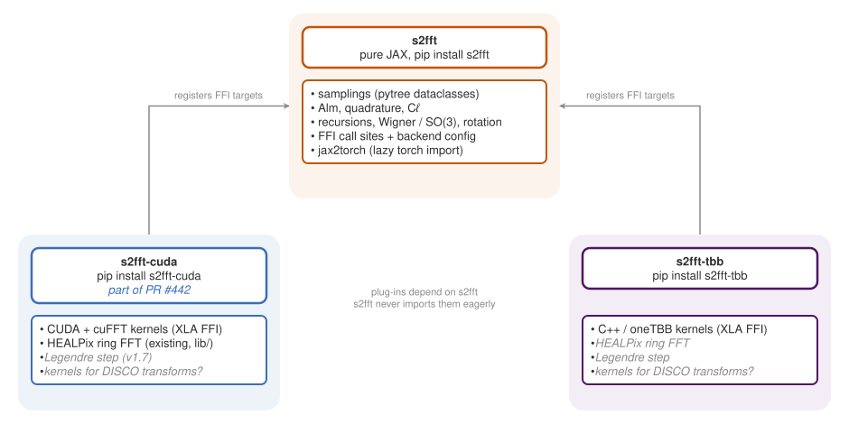
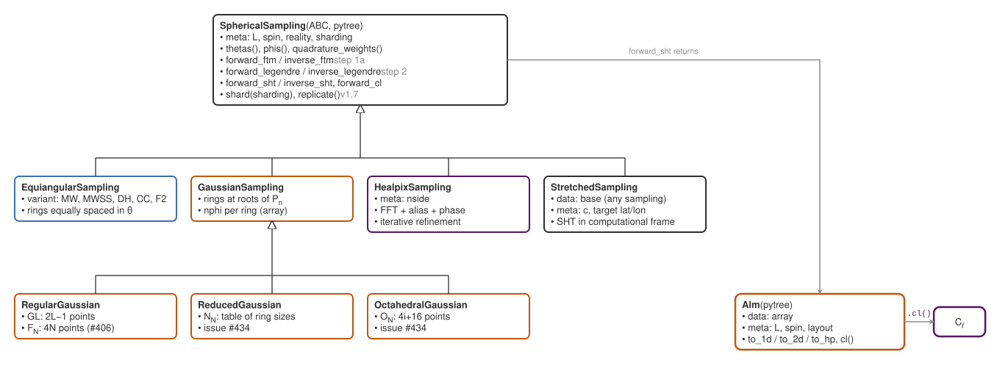
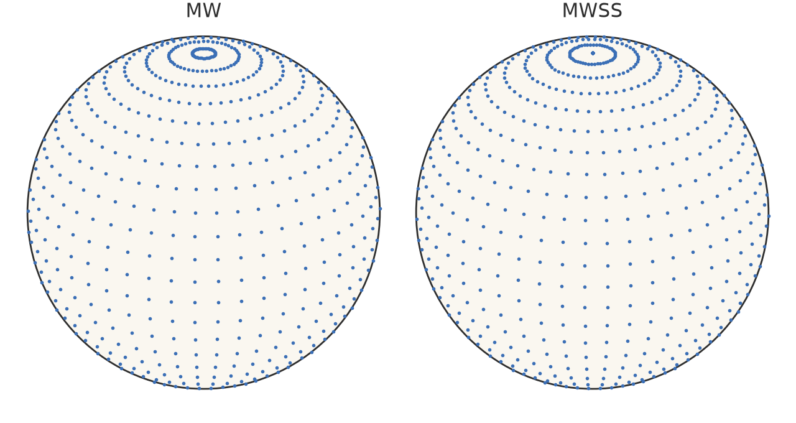
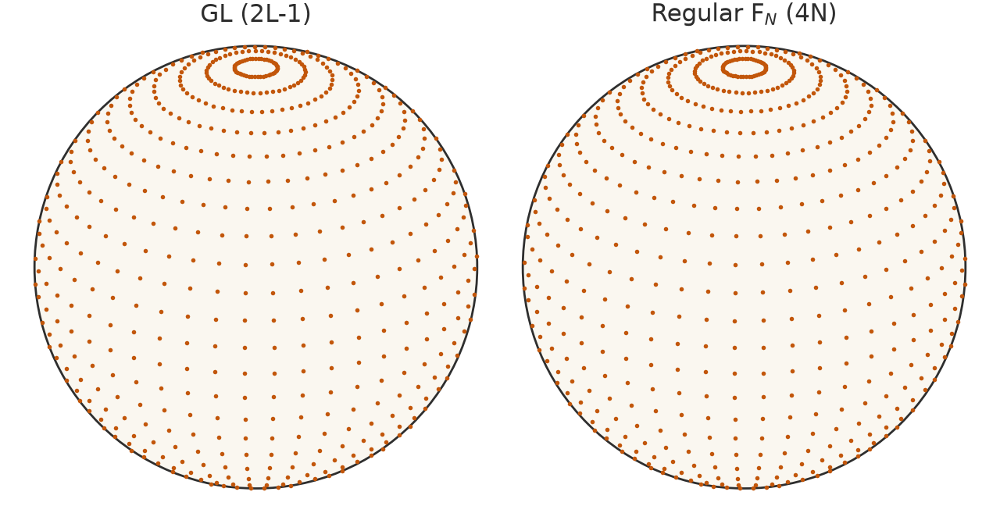
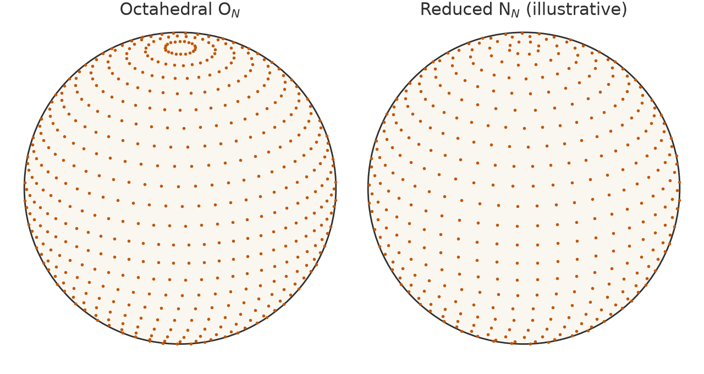
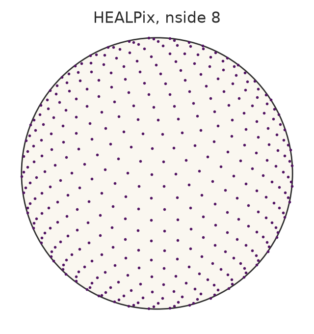
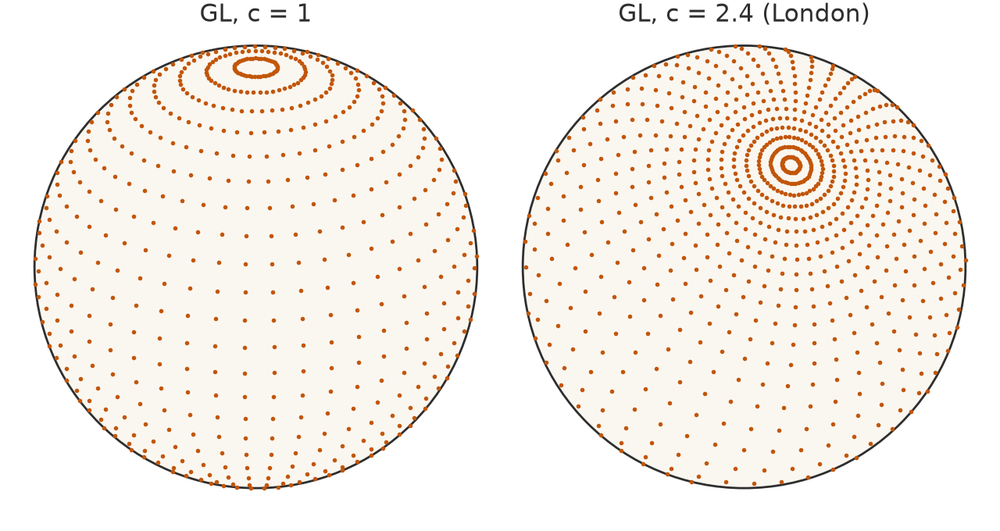
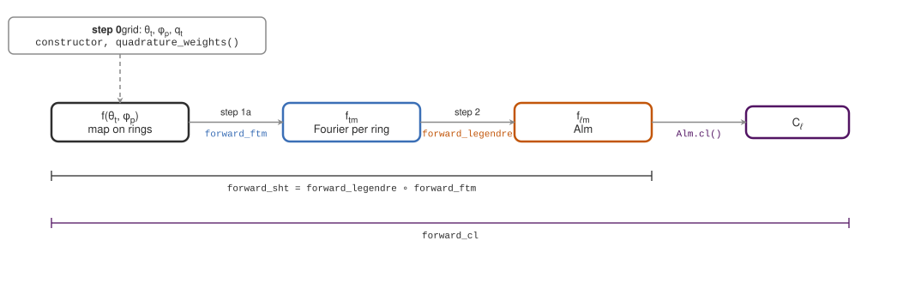
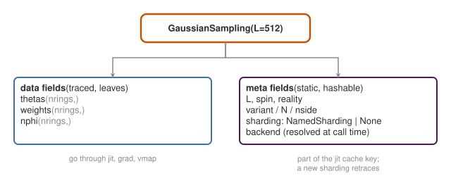
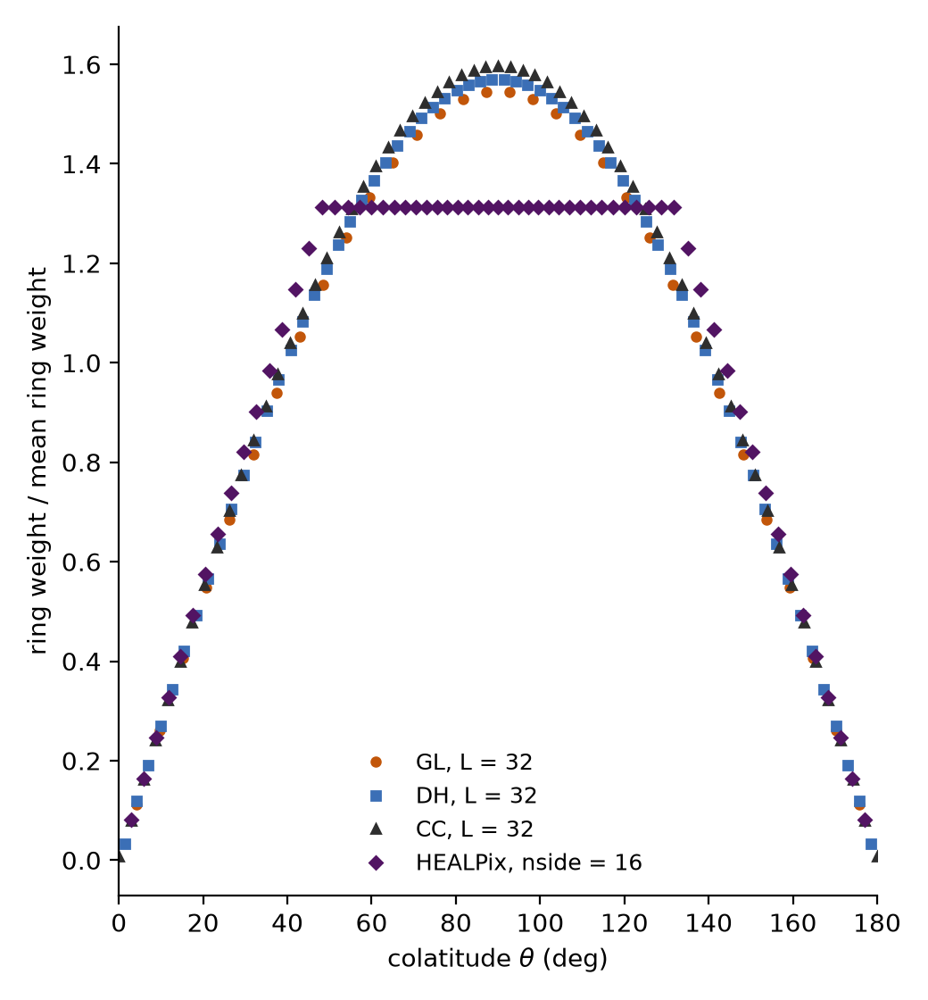

# S2FFT 2.0: a pytree-based rewrite

Design document, draft of 8 November 2026.
Diagrams are `assets/*.drawio.svg` and open for editing in draw.io. The plots in `assets/*.png` are rendered by the scripts in `assets/`.

## 1. Timeline

The rewrite follows the three open milestones of [astro-informatics/s2fft](https://github.com/astro-informatics/s2fft/milestones).

| Milestone | Due | Scope | Issues and the part of the design that closes them |
|---|---|---|---|
| v1.6 | 15 Dec 2026 | Rework; old API kept with `DeprecationWarning` | #340 grid modularization: sampling classes. #341 CUDA plug-in: `s2fft-cuda`. #406 `L x 2L` regular Gaussian: `RegularGaussian`. #353 modular `conftest.py`: one fixture per sampling class. |
| v1.7 | 31 Jan 2027 | Features | #434 reduced grids: `ReducedGaussian`, `OctahedralGaussian`, `StretchedSampling`. #435 PyTorch: `jax2torch`. #436 multi-node / multi-GPU: `.shard()` / `.replicate()`. `forward_cl` on every sampling. |
| v2.0 | 31 Mar 2027 | Old API removed | #349 remove backend-specific variants (`forward_jax`, `forward_numpy`, `forward_torch`, `method=`). #339 Array API refactor: superseded by the JAX-only core (TODO: confirm with the maintainers). |

## 2. S2FFT and upstream infrastructure



- `s2fft` is JAX only. The numpy and torch backends are removed.
- The compiled kernels move to two plug-ins that register XLA FFI targets when imported (#341):
  - `s2fft-cuda` (part of [PR #442](https://github.com/astro-informatics/s2fft/pull/442)): CUDA and cuFFT kernels. It starts with the HEALPix ring FFT that lives today in `lib/` and `utils/healpix_ffts.py`.
  - `s2fft-tbb`: CPU kernels with oneTBB (new).
- The plug-ins depend on `s2fft`; `s2fft` never imports them eagerly.
- Kernels for DISCO transforms? (TODO)

## 3. S2FFT v2.0 internals



Today sampling is dispatched by `if sampling.lower() == ...` branches spread over `transforms/spherical.py`, `utils/quadrature.py` and `sampling/s2_samples.py`. Each branch becomes a method of a class.

- `SphericalSampling` (abstract base, pytree)
  - meta fields: `L`, `spin`, `reality`, `sharding`
  - geometry: `thetas()`, `phis()`, `quadrature_weights()`, `shape`
  - `forward_ftm` / `inverse_ftm` (step 1a)
  - `forward_legendre` / `inverse_legendre` (step 2)
  - `forward_sht` / `inverse_sht`, `forward_cl`
  - `shard(sharding)`, `replicate()`: v1.7 (#436)
- `EquiangularSampling(variant=...)`: MW, MWSS, DH, CC, F2
- `GaussianSampling`
  - `RegularGaussian`: GL ($2L-1$ points) and F$_N$ ($4N$ points, #406)
  - `ReducedGaussian`: N$_N$ (#434)
  - `OctahedralGaussian`: O$_N$ (#434)
- `HealpixSampling`
- `StretchedSampling(base=..., c, target_lat, target_lon)`: wraps any of the above
- `Alm`: the common output of every `forward_sht`

### 3.1 Equiangular



Rings equally spaced in $\theta$. In `sampling/s2_samples.py:t2theta`, MW, MWSS, DH, CC and F2 are all linear in the ring index $t$. Weights come from `quad_weights_{mw,mwss,dh,cc,f2}` in `utils/quadrature_jax.py`.

```python
eq = s2fft.EquiangularSampling(L=256, variant="mw")
ftm = eq.forward_ftm(f)        # step 1a
alm = eq.forward_legendre(ftm) # step 2
alm = eq.forward_sht(f)        # both
f   = eq.inverse_sht(alm)
cl  = eq.forward_cl(f)
```

### 3.2 Gaussian, regular



Rings at the roots of $P_n$ and the same number of points on every ring.

- GL: $L$ rings, $2L-1$ points (the current `"gl"`).
- F$_N$: $2N$ rings, $4N$ points (#406). Step 1a drops the Nyquist order.

```python
gl = s2fft.RegularGaussian(L=256)            # 2L - 1 points
fn = s2fft.RegularGaussian.from_N(N=128)     # 4N points
alm = fn.forward_sht(f)
```

### 3.3 Gaussian, reduced and octahedral



Same Gauss rings, fewer points towards the poles (#434). The N$_N$ panel is illustrative: its ring sizes follow $4N\sin\theta$, not the ECMWF table.

- O$_N$: ring $i$ from the pole has $4i+16$ points.
- N$_N$: ring sizes from a stored table; step 1a keeps $m \le$ NMEN$_t$.
- `nphi` becomes a per-ring array, so `forward_ftm` runs one rFFT per ring (TODO: padded batched FFT vs ragged loop).

```python
on = s2fft.OctahedralGaussian(N=1280)
nn = s2fft.ReducedGaussian(N=320)     # table bundled with s2fft
```

### 3.4 HEALPix



The rings are not Gauss rings, so one pass is not exact. `forward_sht` keeps the iterative refinement of `utils/iterative_refinement.py`.

- Step 1a: FFT, alias and phase shift per ring (`utils/healpix_ffts.py`).
- The CUDA ring FFT moves to `s2fft-cuda`.

```python
hp  = s2fft.HealpixSampling(nside=512, L=1024)
alm = hp.forward_sht(m, iter=3)
```

### 3.5 Stretched



The Schmidt map $\tan(\vartheta/2) = \tan(\theta/2)/c$ is followed by a rotation of the pole to the target. It acts on points, so it wraps any base sampling.

- The SHT runs in computational coordinates on the base grid.
- `thetas()` / `phis()` return the Earth positions. The weights get the area factor $A(\theta)$.

```python
st = s2fft.StretchedSampling(
    base=s2fft.RegularGaussian(L=512),
    c=2.4, target_lat=51.5, target_lon=-0.13)
alm = st.forward_sht(f)  # base.forward_sht in computational frame
```

## 4. The separable SHT as methods



The steps follow the ring-grid study (`sht_schmidt_so3_study.pdf`, section 1):

| Step | Content | Method |
|---|---|---|
| 0 | grid: ring latitudes $\theta_t$, points $\phi_p$, weights $q_t$ | constructor, `quadrature_weights()` |
| 1a | one FFT per ring gives $f_{tm}$ | `forward_ftm` |
| 2 | $f_{\ell m} = \sum_t q_t \lambda_{\ell m}(\theta_t) f_{tm}$ | `forward_legendre` |

`forward_sht = forward_legendre ∘ forward_ftm` and `forward_cl = Alm.cl ∘ forward_sht`.

Step 1a per grid (study, section 7):

| | GL | F$_N$ | O$_N$ | N$_N$ | HEALPix |
|---|---|---|---|---|---|
| step 1a | 2D rFFT | 2D rFFT, drop Nyquist | rFFT per ring | rFFT, keep $m \le$ NMEN$_t$ | FFT, alias, phase |
| one pass | exact | exact | exact on O8 | $\sim 10^{-6}$ | $\sim 10^{-2}$, iterate |

## 5. Pytree layout



```python
@jax.tree_util.register_dataclass
@dataclasses.dataclass(frozen=True)
class GaussianSampling(SphericalSampling):
    thetas: jax.Array                     # data field
    weights: jax.Array                    # data field
    L: int = jax.tree.static()            # meta field (JAX >= 0.9)
    sharding: jax.sharding.Sharding | None = jax.tree.static(default=None)
```

- Data fields (arrays: `thetas`, `weights`, `nphi`) are leaves and go through `jit`, `grad` and `vmap`.
- Meta fields (`L`, `spin`, `reality`, variant, `N`, `nside`, `sharding`) are static and part of the `jit` cache key, so a new sharding retraces.
- The sharding is stored as a static field, following `field_sharding` in jax-fli `_core.py`. jax-fli uses `eqx.field(static=True)`; here `register_dataclass` is used with no Equinox dependency.
- The snippet above was checked with JAX 0.11.2. `jax.tree.static()` needs JAX ≥ 0.9, but `pyproject.toml` pins `jax>=0.5`; there the form is `dataclasses.field(metadata=dict(static=True))` (TODO).

## 6. A common `Alm` class

Every `forward_sht` returns an `Alm` pytree, whatever the sampling. The layouts reuse `sampling/reindex.py`. The 2D layout stores zeros for $|m| > \ell$, and the HEALPix layout keeps only $m \ge 0$ of a real signal (`flm_2d_to_hp_fast` docstring). Rotation reuses `rotate_flms` from `utils/rotation.py`.

```python
from dataclasses import dataclass, replace
from typing import Literal, Self
import jax
import jax.numpy as jnp
from jax import Array
from jax.sharding import Sharding
from jax.tree import static
from s2fft.sampling import reindex

Layout = Literal["2d", "1d", "hp"]

@jax.tree_util.register_dataclass
@dataclass(frozen=True)
class Alm:
    """Output of every forward_sht."""

    array: Array    # data field, (L, 2L-1) in "2d"
    L: int = static()
    spin: int = static(default=0)
    reality: bool = static(default=False)
    layout: Layout = static(default="2d")
    sharding: Sharding | None = static(default=None)

    # layouts, from sampling/reindex.py
    def to_2d(self) -> Self: ...  # flm_*_to_2d_fast
    def to_1d(self) -> Self: ...  # flm_2d_to_1d_fast
    def to_hp(self) -> Self: ...  # real only, m >= 0

    # spectra ("2d" stores zeros for |m| > l)
    def cl(self, other: Self | None = None) -> Array:
        a = self.to_2d().array
        b = a if other is None else other.to_2d().array
        nm = 2 * jnp.arange(self.L) + 1
        return (a * b.conj()).real.sum(-1) / nm

    # arithmetic: same L, spin, layout
    def __add__(self, o: Self) -> Self:
        return replace(self, array=self.array + o.array)
    def __mul__(self, x) -> Self: ...  # scalar or b_ell

    # rotation, from utils/rotation.py (rotate_flms)
    def rotate(self, alpha, beta, gamma) -> Self: ...

    # distribution (v1.7)
    def shard(self, sharding: Sharding) -> Self: ...
    def replicate(self) -> Self: ...
```

```python
alm  = gl.forward_sht(f)          # Alm, layout "2d"
cl   = alm.cl()                   # auto-spectrum
xcl  = alm.cl(hp.forward_sht(m))  # cross-spectrum
f_hp = hp.inverse_sht(alm)        # any sampling
```

## 7. Quadrature and $C_\ell$

- One `quadrature_weights()` per class replaces the `if sampling.lower() == ...` chain in `quad_weights_transform` (`utils/quadrature_jax.py`). The `quad_weights_*` functions are reused as they are.
- `forward_cl(f)` is `forward_sht(f).cl()` on every sampling, including reduced and stretched grids.
- Steps 1a and 2 are also exposed on their own: `forward_ftm` / `inverse_ftm` and `forward_legendre` / `inverse_legendre` (from `transforms/otf_recursions.py`).

Today (excerpt of `utils/quadrature_jax.py`):

```python
def quad_weights_transform(L, sampling="mwss", nside=0):
    if sampling.lower() == "mwss":
        return (quad_weights_mwss_theta_only(2 * L)
                * 2 * jnp.pi / samples.nphi_equiang(L, "mwss"))
    elif sampling.lower() == "dh":
        return quad_weights_dh(L)
    elif sampling.lower() == "gl":
        return quad_weights_gl(L)
    elif sampling.lower() == "healpix":
        return quad_weights_hp(nside)
    ...
```

In the rewrite:

```python
class RegularGaussian(GaussianSampling):
    def quadrature_weights(self) -> Array:
        return quad_weights_gl(self.L)    # reused as is

w   = gl.quadrature_weights()             # (nrings,)
cl  = gl.forward_cl(f)                    # = gl.forward_sht(f).cl()
ftm = gl.forward_ftm(f)                   # step 1a only
alm = gl.forward_legendre(ftm)            # step 2 only
```



Ring weights (per-pixel weight times points per ring) from s2fft's `quad_weights` and `quad_weights_hp`, divided by their mean. Each set sums to $4\pi$.

## 8. Parts that do not move yet

| Module | Today | In the rewrite | Milestone |
|---|---|---|---|
| `transforms/wigner.py` | `sampling=` string; loops the spherical transform over $n$ | `SO3Sampling(base=...)` wrapping an S² sampling | TODO |
| `recursions/` (Price-McEwen, Risbo, Turok) | free functions | unchanged, called by `forward_legendre` | TODO |
| `precompute_transforms/` | kernel builders + transforms | TODO | TODO |
| `utils/rotation.py` | `rotate_flms` | `Alm.rotate` | TODO |
| `utils/signal_generator.py` | `generate_flm` | returns `Alm` | TODO |
| `utils/iterative_refinement.py` | wraps forward / inverse | used by `HealpixSampling.forward_sht` | TODO |
| `base_transforms/` (numpy reference) | numpy only | kept in tests as reference, out of the public API | TODO |

All of them take the sampling pytree instead of the `sampling=`, `nside=` and `L=` arguments:

```python
s2fft.wigner.forward(f, L, N, sampling="mw")   # today
SO3Sampling(base=eq, N=N).forward(f)           # TODO
```

## 9. Build and backends

Where the compiled code goes:

```text
today                     rewrite
s2fft/                    s2fft/        pure JAX
├── CMakeLists.txt        └── src/s2fft/
├── lib/
│   ├── include/  7 hdr   s2fft-cuda/   from lib/, PR #442
│   └── src/  5 .cc/.cu   ├── lib/      CUDA, cuFFT
└── src/s2fft/            └── pyproject.toml

                          s2fft-tbb/    new lib/
                          ├── lib/      C++, oneTBB
                          └── pyproject.toml
```

- `lib/` and `CMakeLists.txt` move to `s2fft-cuda` (part of [PR #442](https://github.com/astro-informatics/s2fft/pull/442)); a new `lib/` is written for `s2fft-tbb`.
- The stub `_s2fft` built without CUDA is no longer needed.
- Location of the plug-ins: a separate path in the s2fft repo, or their own repos in astro-informatics (TODO: to be discussed).

Packaged, one command each:

```bash
pip install s2fft            # JAX only
pip install "s2fft[cuda]"    # + s2fft-cuda
pip install "s2fft[tbb]"     # + s2fft-tbb
```

- Prebuilt wheels on PyPI, built with cibuildwheel (already used by s2fft).
- No compiler or CUDA toolkit on the user side.

```python
s2fft.config.update("S2FFT_BACKEND", "jax")
s2fft.config.update("S2FFT_BACKEND", "cuda")
s2fft.config.update("S2FFT_BACKEND", "tbb")
```

- `"jax"` is the default backend. No config exists today: dispatch goes through `method=` strings.
- TODO: an `S2FFT_BACKEND` environment variable and a context manager.
- TODO: raise an error or fall back to `"jax"` when the plug-in is missing.

## 10. Compute examples

```python
import jax, s2fft
jax.config.update("jax_enable_x64", True)

gl = s2fft.RegularGaussian(L=512)
f = jax.random.normal(jax.random.key(0), gl.shape)

alm = gl.forward_sht(f)                     # Alm
w = gl.quadrature_weights()                 # (nrings,)
cl = gl.forward_cl(f)                       # (L,)
ftm = gl.forward_ftm(f)                     # step 1a only
alm2 = gl.forward_legendre(ftm)             # step 2 only

loss = lambda f: (gl.forward_cl(f) ** 2).sum()
g = jax.grad(loss)(f)                       # differentiable end to end

# TODO (v1.7): distributed
mesh = jax.make_mesh((4,), ("rings",))
gl_sh = gl.shard(jax.NamedSharding(mesh, jax.P("rings")))
alm = jax.jit(gl_sh.forward_sht)(f)
```

## 11. PyTorch through `jax2torch`

- The torch backend is removed; torch users wrap the JAX methods.
- The wrapper builds on the existing `utils/torch_wrapper.py`: DLPack conversion, a `torch.autograd.Function` around `jax.vjp`, and conjugation of complex gradients.
- Torch is imported lazily, only when the wrapper is called.

```python
from s2fft.torch import jax2torch
gl = s2fft.RegularGaussian(L=256)
sht = jax2torch(gl.forward_sht)     # returns a torch-callable
alm = sht(torch_tensor)             # torch.Tensor in, torch.Tensor out, autograd works
```

TODO: to be decided. Keep `wrap_as_torch_function` as is, or return `Alm` as a tensor plus metadata.

## 12. Deprecation path

```python
# v1.6: old call still works
flm = s2fft.forward(f, L, sampling="gl", method="jax")
# DeprecationWarning: use s2fft.RegularGaussian(L).forward_sht(f)
```

- v1.6: `s2fft.forward` / `s2fft.inverse` become shims that build the sampling object and call the method.
- v1.6: `method="numpy"` and `method="torch"` warn and run the JAX path.
- v1.6: `method="jax_cuda"` warns and maps to `S2FFT_BACKEND="cuda"`.
- `method="jax_healpy"` (the healpy wrapper) is removed as an option, closing [PR #440](https://github.com/astro-informatics/s2fft/pull/440): the CUDA kernels in the private CUDA PR are faster.
- v2.0: the shims, `*_numpy`, `*_jax`, `*_torch` and `method=` are removed (#349).

## 13. TODO

- [ ] Class names: `RegularGaussian` vs `GaussianSampling(variant=...)`; `EquiangularSampling(variant=...)` vs one class per scheme.
- [ ] Static-field syntax for the pinned JAX version (`jax.tree.static()` needs JAX ≥ 0.9).
- [ ] Sharding axis: rings for step 1a, $m$ for step 2, and the transpose between them.
- [ ] Scope of the `s2fft-tbb` kernels (ring FFT only, or Legendre too).
- [ ] Kernels for DISCO transforms in `s2fft-cuda` / `s2fft-tbb`?
- [ ] Final form of `jax2torch`.
- [ ] Wigner / SO(3) migration: `SO3Sampling(base=...)`.
- [ ] Ragged rings (reduced, octahedral, HEALPix): padded batched FFT vs per-ring loop (WIP in private CUDA PR).
- [ ] Reduced Gaussian $N_N$ ring-size table: source and licence.
- [ ] Status of the Array API refactor (#339) under a JAX-only core.
